<picture>
  <source media="(prefers-color-scheme: dark)" srcset="dark.svg">
  <source media="(prefers-color-scheme: light)" srcset="light.svg">
  
</picture>

---

## 📜 À propos

Juriste de formation, j'ai opéré une **reconversion vers la cybersécurité**, avec un ancrage fort sur la **détection, la réponse à incident et la conformité**. Mon M1 Expert Réseaux, Infrastructures & Sécurité (ORT Toulouse · 3iL Ingénieurs) me donne les bases techniques — Linux, SIEM, réseaux — pour analyser un incident de sécurité sous l'angle **technique autant que réglementaire**.

Après une mission de **cheffe de projet cybersécurité chez COS2i**, je poursuis mon M2 en alternance chez **NGE comme analyste SOC**, en contrat de professionnalisation jusqu'en septembre 2027.

- 🛡️ **Analyste SOC — NGE** · contrat de professionnalisation (sept. 2026 – sept. 2027), rythme 3 semaines entreprise / 1 semaine école
- 🎓 Master Expert Réseaux, Infrastructures & Sécurité — **M1 obtenu (mai 2026)** · **M2 en cours (2026–2027)**
- 🏛️ École : ORT Toulouse / 3iL Ingénieurs
- 📜 Certificat Cybersécurité Google (mai 2025)
- ⚖️ Socle juridique : Master en Droit Public — Université Aix-en-Provence
- 🌐 TOEIC 710 pts — Niveau B2

---

## 🛠️ Stack Technique

**Sécurité & GRC**

**Systèmes & Infrastructure**

**Réseaux & ITSM**

**Cloud & DevOps**

---

## 🎯 Expertise

<strong>🔐 Sécurité & GRC</strong>

 

| Domaine | Maîtrise |
|---|---|
| Sekoia.io (SIEM / SOAR) | ████████░░ 82% |
| Microsoft Defender XDR | ████████░░ 80% |
| Wazuh SIEM/EDR | ████████░░ 82% |
| Analyse de risques SI | ████████░░ 78% |
| RGPD / Conformité | ████████░░ 85% |
| NIST | ███████░░░ 74% |
| Wireshark / VirusTotal | ███████░░░ 70% |
| SOAR — TheHive / Cortex / Shuffle | ████████░░ 77% |

<strong>🖥️ Systèmes & Infra</strong>

 

| Domaine | Maîtrise |
|---|---|
| Linux Debian | ████████░░ 80% |
| Stack LAMP | ███████░░░ 72% |
| VMware / VirtualBox | ████████░░ 75% |
| Active Directory / IAM | ███████░░░ 68% |
| Bash / PowerShell | ██████░░░░ 65% |
| Zabbix 7.0 — Supervision | ████████░░ 75% |

<strong>🌐 Réseaux & ITSM</strong>

 

| Domaine | Maîtrise |
|---|---|
| GLPI (ITSM/ITAM) | ████████░░ 80% |
| Nextcloud | ████████░░ 76% |
| VLAN / VPN / Firewall | ███████░░░ 72% |
| DHCP / DNS / FTP | ███████░░░ 70% |
| Suite Office | █████████░ 90% |

<strong>☁️ Cloud & DevOps</strong>

 

| Domaine | Maîtrise |
|---|---|
| Amazon AWS (EKS · S3 · IAM · KMS) | ███████░░░ 74% |
| Kubernetes / Helm | ███████░░░ 72% |
| Terraform (IaC) | ███████░░░ 70% |
| Velero / Kopia / DR | ███████░░░ 68% |
| Docker / Rancher v2.9.3 | ██████░░░░ 65% |
| GitHub Actions (CI/CD) | ██████░░░░ 62% |

---

## 🚀 Projets phares

<strong>🛡️ Wazuh SIEM / EDR — Projet phare</strong>

 

Déploiement complet d'une infrastructure de surveillance centralisée sur Debian 12 : centralisation des logs multi-sources, détection d'intrusions en temps réel, agents sur plusieurs machines Linux & Windows.

| | |
|---|---|
| **Stack** | Wazuh Manager + Agents, VMware, Debian 12 |
| **Focus** | Centralisation · Alertes · Audit |
| **Rapport** | [Voir le rapport](https://drive.google.com/file/d/1HPmBCzCME23pfI-i-Us2Gd8sgLCN9EAz/preview) |
| **Repository** | [Runbook Wazuh](https://github.com/AmelieGarnier/Wazuh-Suricata/blob/main/Runbooks/wazuh-runbook.md) |

<strong>🔍 Suricata IDS/IPS</strong>

 

Déploiement de Suricata en mode IDS/IPS : analyse de trafic réseau, écriture de règles de détection, inspection des alertes et corrélation avec les journaux système.

| | |
|---|---|
| **Stack** | Suricata + Wazuh, VMware, Debian 12 |
| **Focus** | Règles personnalisées · Alertes · Corrélation |
| **Rapport** | [Voir le rapport](https://drive.google.com/file/d/1RwhRDXqYxuPoCR2KLgp0hwKfXsk-L7gZ/preview) |
| **Repository** | [Runbook Suricata](https://github.com/AmelieGarnier/Wazuh-Suricata/blob/main/Runbooks/suricata-runbook.md) |

<strong>⚡ SOAR — TheHive 4 · Cortex · Shuffle</strong>

 

Plateforme SOAR open source sur Docker, intégrée à Wazuh & Suricata : trois scénarios automatisés (brute force SSH, scan de ports, exfiltration DNS) avec enrichissement AbuseIPDB / VirusTotal, blocage Active Response conditionnel et notifications Discord.

| | |
|---|---|
| **Stack** | Docker, Debian 12, TheHive 4, Cortex, Shuffle |
| **Performance** | MTTD 20s · MTTR < 1s |
| **Sécurité** | Taux de blocage 100% · Alignement MITRE ATT&CK |
| **Impact** | Automatisation complète de 3 scénarios d'incident |
| **Rapport** | [Voir le rapport](https://drive.google.com/file/d/18TmBshdlp8FScTzilm_vX-ezZPLOpNLm/preview) |
| **Repository** | [Runbook SOAR](https://github.com/AmelieGarnier/SOAR/blob/main/runbook-soar.md) |

<strong>🖥️ Active Directory — IAM & GPO</strong>

 

Mise en place d'un domaine Active Directory sur Windows Server : gestion utilisateurs, groupes, OU, déploiement de GPO et configuration des droits d'accès.

| | |
|---|---|
| **Stack** | VMware, Windows Server, AD DS, DNS, GPO |
| **Focus** | IAM · Droits d'accès |
| **Rapport** | [Voir le rapport](https://drive.google.com/file/d/1VDs4lS5txty9b0A4D3HG80JUUUaY7bKI/preview) |

<strong>📶 Zabbix 7.0 LTS — Supervision</strong>

 

Déploiement d'un serveur Zabbix 7.0 LTS sur VM Debian 13 dédiée. Supervision de 7 services critiques (Wazuh, SOAR, Active Directory) via agents et checks TCP, triggers multi-sévérités, alertes Discord en temps réel.

| | |
|---|---|
| **Stack** | Zabbix 7.0 LTS, Debian 13, MariaDB |
| **Performance** | Alertes en moins d'1 minute |
| **Rapport** | [Voir le rapport](https://drive.google.com/file/d/1oOjuTd7FNHgYL0heBT_UPryqobjS2fbB/preview) |
| **Repository** | [Runbook Zabbix](https://github.com/AmelieGarnier/Zabbix) |

<strong>🔄 Disaster Recovery — Kubernetes</strong>

 

Déploiement d'une architecture DR sur Kubernetes avec Rancher, RKE2, MinIO et Velero : sauvegardes programmées, simulation de sinistre et restauration complète d'un cluster en environnement virtualisé.

| | |
|---|---|
| **Stack** | Kubernetes, Rancher, RKE2, MinIO, Velero |
| **Focus** | PRA · Résilience · RPO / RTO |
| **Rapport** | [Voir le rapport](https://drive.google.com/file/d/1irBSg0TbTwxmFRHzX3D0geyTg52CJKyw/preview) |

<strong>☁️ Nextcloud — Cloud privé souverain</strong>

 

Cloud privé sur VM Debian 12 avec stack LAMP et MariaDB, axé sur la souveraineté des données, avec tests fonctionnels de partage et de synchronisation.

| | |
|---|---|
| **Stack** | LAMP, MariaDB, Debian 12 |
| **Focus** | Souveraineté des données |
| **Rapport** | [Voir le rapport](https://drive.google.com/file/d/1bB0uUpDMYY6q0cEzahezBX6ScjmWqTnZ/preview) |

<strong>🗂️ GLPI 10.0.17 — ITSM / ITAM</strong>

 

Installation et configuration de GLPI sur Debian 12, inventaire automatique Windows et Linux via FusionInventory, workflows de tickets et gestion des actifs.

| | |
|---|---|
| **Stack** | GLPI 10.0.17, Debian 12, FusionInventory |
| **Focus** | Tickets · Gestion des actifs |
| **Rapport** | [Voir le rapport](https://drive.google.com/file/d/1kzkizBTBzFloe5_3PRPLa82EfRQvy3L4/preview) |

---

## 🧭 Parcours

| Période | Poste / Formation | Structure |
|---|---|---|
| Sept. 2026 – Sept. 2027 · *en cours* | **Analyste SOC** — contrat de professionnalisation | NGE |
| 2026 – 2027 · *en cours* | **M2 Expert Réseaux, Infrastructures et Sécurité** | ORT Toulouse / 3iL Ingénieurs |
| Août – Sept. 2026 | Cheffe de projet cybersécurité | COS2i |
| Mai 2026 · ✓ obtenu | M1 Expert Réseaux, Infrastructures et Sécurité | ORT Toulouse / 3iL Ingénieurs |
| Mai 2025 · ✓ obtenu | Certificat Cybersécurité Google | Google / Coursera |
| Juil. – Sept. 2024 | Assistante Juridique aux Assurances | NGE |
| 2021 – 2023 | Assistante Préparatrice de Commandes | XPO Logistics |
| 2016 – 2021 | Chargée de Gestion Administrative | Alpes Administration Services |
| 2013 – 2016 | Collaboratrice Juridique | Alpes Juridique Conseil |
| 2012 – 2013 · ✓ obtenu | Master en Droit Public | Université Aix-en-Provence |

---

## 📊 GitHub Analytics

---

## 🏅 GitHub Trophies

---

## 📈 Activité de contribution

---

## 🐍 Contribution Snake

---

## 🎯 Focus actuel

